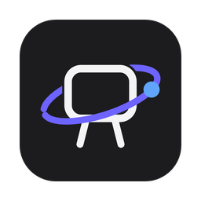

<p align="center"></p>

# Board, by Apollo

**An open-source desktop app for teachers to make maths and science visible**, using the AI subscription they already have. Built by the Apollo team · [apollolearn.app](https://apollolearn.app)

Describe an idea, and Claude Code or Codex builds it for you as one of three things:

| | Made with | You get |
|---|---|---|
| **Video** | [Manim Community](https://github.com/ManimCommunity/manim), rendered on your computer | MP4 with captions, or a GIF, in 16:9 or 9:16 |
| **Web animation** | [manim-web](https://github.com/maloyan/manim-web), plays in any browser | One HTML file, or a GIF |
| **Lab** | An interactive page (sliders, simulations, checks) | One HTML file |

Then keep shaping it: click anything in the preview and say what should change, add narration with a free local AI voice or your own recording, and roll back to any earlier version.

## Highlights

- **Local only.** No account and nothing uploaded. Projects are plain folders in your Documents. The only thing that goes online is your assistant (Claude Code or Codex) talking to its own service.
- **Uses your own Claude Code or Codex sign-in.** No API keys, no extra subscription. Board drives the CLI you already have installed.
- **A guided start.** The assistant asks a few quick multiple-choice questions (class level, takeaway, style) before it builds.
- **Start from a script.** Paste your narration; it becomes scenes whose visuals follow your words, then it's voiced for you.
- **Click to edit.** Select a part of a Lab, a web animation, or an object in a rendered Manim video, and the assistant gets its name, scene, time and source line.
- **The assistant checks its own work.** It renders a preview, reads console errors and looks at screenshots before it says it's done.
- **Narration that drives the timing.** Put `{{mark:name}}` before a word; animations wait for that word. AI voice (Kokoro, local and free) or your own recording (aligned with Whisper, local).
- **You choose what the assistant may do.** Ask first, Auto (commands and web inside the project folder) or Full access, next to the model picker.
- **Versions.** Every change is saved. Undo, or restore any earlier version. (It's git under the hood; you never see it.)

## Repository

```
apps/desktop          Electron app (electron-vite, React, Tailwind)
packages/shared       Types shared by the main process and the UI
packages/lab-kit      Styles, web components and vendored libraries for Labs
packages/agent-kit    Instructions and library guides given to the assistant
python/studio_manim   Manim plugin: render timeline, click-to-edit data, narration sync
docs/ARCHITECTURE.md  How it fits together
```

The look follows Apollo's Study Space design (Figtree, zinc surfaces, hairline borders, one indigo action per screen, blue for the assistant), in light and dark.

## Develop

Requirements: Node 22+, pnpm, and Claude Code (`claude`) or Codex (`codex`) installed and signed in.

```sh
pnpm install
pnpm dev            # desktop app with hot reload
```

Videos need Python, Manim and LaTeX. The app installs them into its own folder the first time you make a video, so you don't have to.

### Self-tests

The main process has a self-test mode that exercises the real pipeline without clicking through the UI:

```sh
cd apps/desktop && pnpm build
STUDIO_SELFTEST=./selftest-out STUDIO_SELFTEST_MODE=build npx electron .   # build sample Lab + web animation, screenshots
STUDIO_SELFTEST_MODE=agent STUDIO_SELFTEST_AGENT=claude ...                # a real assistant turn (claude | codex)
STUDIO_SELFTEST_MODE=guided ...                                            # guided start with the question card
STUDIO_SELFTEST_MODE=access ...                                            # approval cards: ask, deny, auto
STUDIO_SELFTEST_MODE=voice ...                                             # AI narration + speech alignment
STUDIO_SELFTEST_MODE=video ...                                             # Manim setup, render, timeline, narration
STUDIO_SELFTEST_MODE=formats ...                                           # vertical video and web animation, GIF export
STUDIO_SELFTEST_MODE=ui ...                                                # screenshots of the real UI
```

Use `STUDIO_PROJECTS_DIR` and `STUDIO_DATA_DIR` to keep test projects and downloads out of your real folders.

### Release

Push a tag like `v0.1.0`. GitHub Actions builds installers for Windows, macOS and Linux and attaches them to a GitHub Release. The app never checks for updates on its own.

## License

MIT
