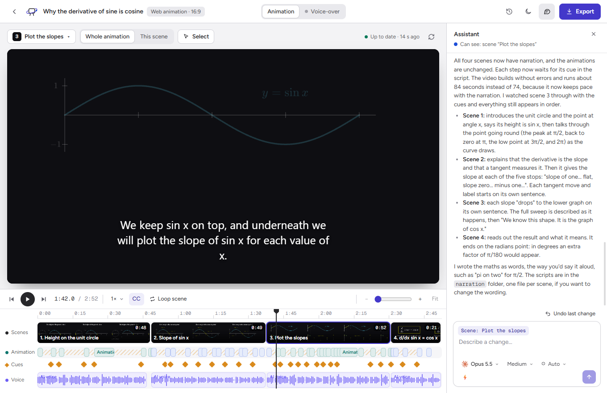
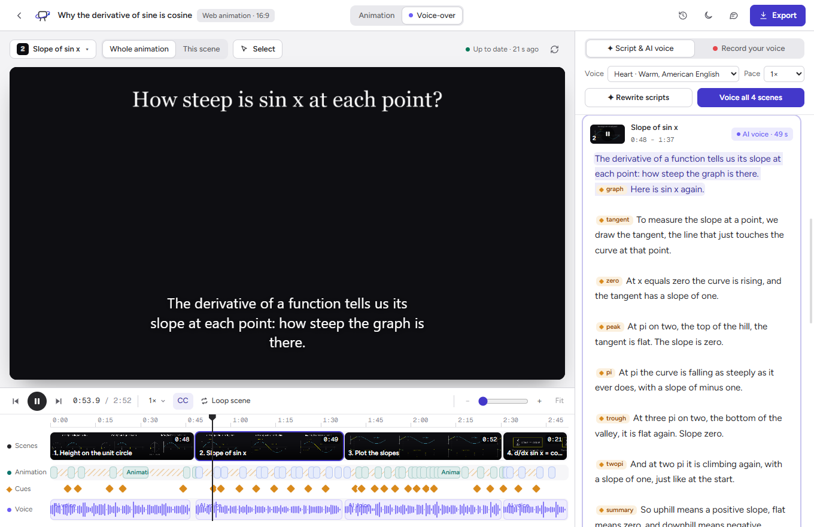
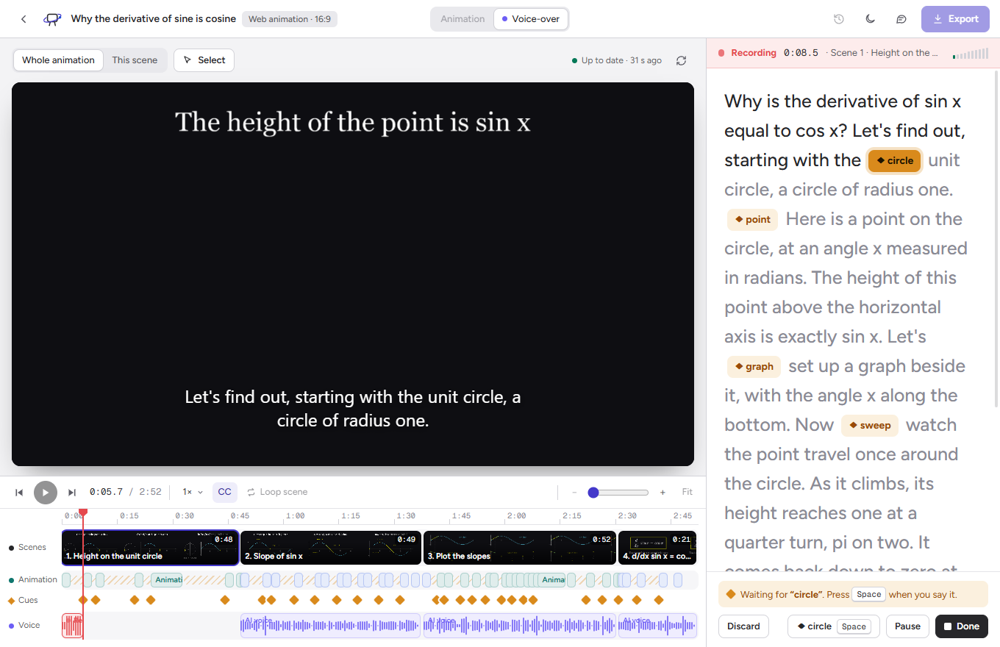
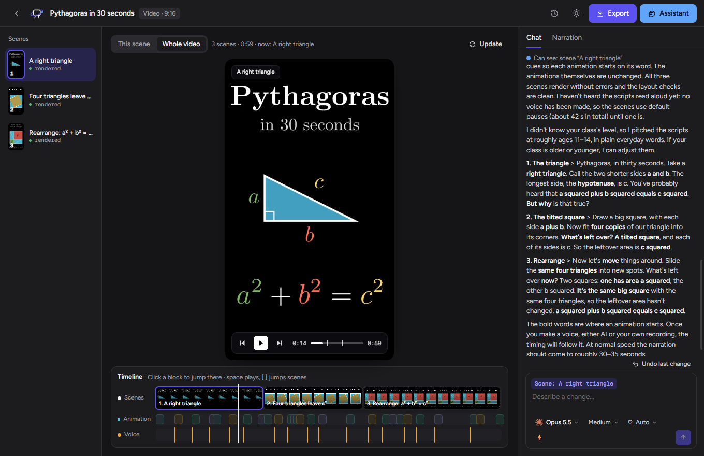
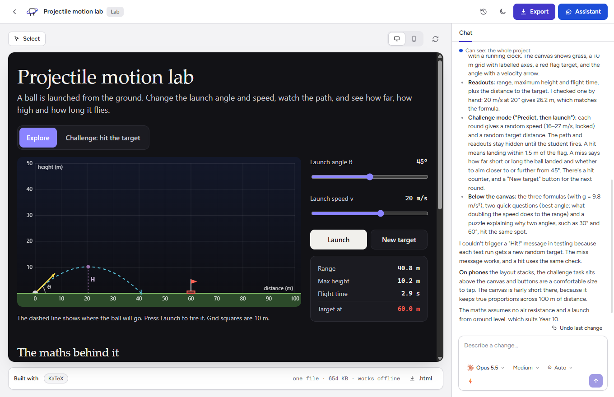
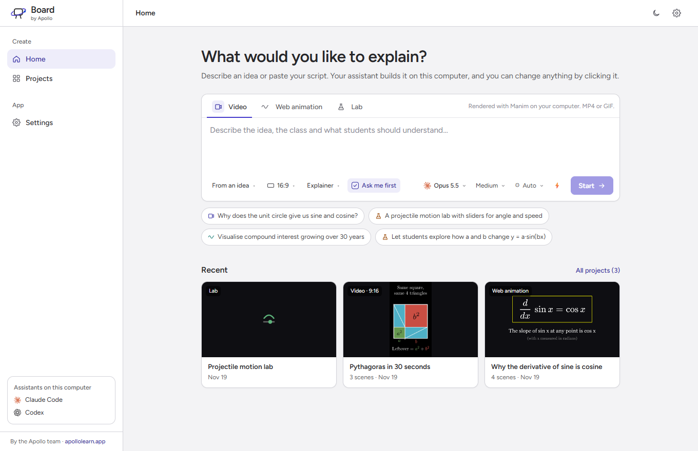

<p align="center">
  <picture>
    <source media="(prefers-color-scheme: dark)" srcset="apps/desktop/build/brand/mark-dark.svg">
    
  </picture>
</p>

<h1 align="center">Board</h1>

<p align="center">
  <b>Make maths and science visible, with the AI subscription you already have.</b><br>
  Manim videos, web animations and interactive Labs, built on your computer by Claude Code or Codex.
</p>

<p align="center">
  Built by the Apollo team · <a href="https://apollolearn.app">apollolearn.app</a> · MIT licensed · Windows, macOS, Linux
</p>

<p align="center">
  
</p>

---

Board is an open-source desktop app for teachers. Describe an idea, or paste a script, and your own Claude Code or Codex builds it as one of four things:

| | Made with | You get |
|---|---|---|
| **Video** | [Manim Community](https://github.com/ManimCommunity/manim), rendered on your computer | MP4 with captions, or a GIF · 16:9 or 9:16 |
| **Web animation** | [manim-web](https://github.com/maloyan/manim-web), plays in any browser | One HTML file, or a GIF · 16:9 or 9:16 |
| **Lab** | An interactive page in whatever form fits: a simulation, an explorable essay, a puzzle, sliders and checks | One HTML file that works offline |
| **Slides** | A deck you present step by step: Manim or manim-web animations, HTML and interactive slides | One HTML file you present from any browser · 16:9 or 9:16 |

Then keep shaping it: click anything in the preview and say what should change, add a voice-over, and go back to any earlier version.

## Features

**Start the way you think**
- **A guided start.** The assistant asks a few quick, clickable questions first (class level, what students should take away, style, pacing), then builds.
- **Start from a script.** Paste your narration; it's split into scenes whose visuals follow your words, then voiced for you.
- **Short or long, landscape or vertical.** From a 20-second reel to a full lesson.

**See it, scrub it, change it**
- **A real timeline.** Scenes, every animation step, the ◆ cues and the voice on one zoomable strip. Scrub, change speed, loop a scene, turn captions on and off; click a step to see where it comes from and ask for a change. Keyboard: Space, ← →, `,` `.` for frames, `[` `]` for scenes.
- **Click to edit.** Select an object in a video, a web animation or a Lab, and the assistant knows exactly which part you mean, down to the source line.
- **Undo and versions.** Every change is saved. Undo the last one, or restore any earlier version.

**Voice-over that drives the timing**
- **Script & AI voice.** Write each scene's script yourself or have the assistant write it, then an AI voice that runs on your computer (Kokoro) reads it.
- **Record your own voice.** The animation plays scene by scene while you read from a teleprompter. It holds at each ◆ cue until you press Space, so the picture moves exactly when you say the word.
- **Fix a take like a document.** Every word you said sits under the waveform (Whisper, also local). Select words to cut them or re-record just that bit, drag a cue to retime an animation, and switch between takes. Every take is kept.
- Put a `{{mark:name}}` cue before a word and the animation waits for it. Captions come for free.

**An assistant that checks its own work**
- Renders and reports problems in plain words: labels overlapping, text cut off at the frame edge, text too small, pages that scroll sideways on phones.
- Reviews every animation step in one picture, tries Labs like a student (moves sliders, clicks buttons), and can see exactly what you're looking at.
- You choose what it may do: **Ask first**, **Auto** (commands and web inside the project folder) or **Full access**.

**Yours, on your computer**
- No account and nothing uploaded. Projects are plain folders in your Documents.
- The only thing that goes online is your assistant (Claude Code or Codex) talking to its own service.
- Light and dark themes.

<table>
  <tr>
    <td></td>
    <td></td>
  </tr>
  <tr>
    <td></td>
    <td></td>
  </tr>
  <tr>
    <td colspan="2"></td>
  </tr>
</table>

## Get started

1. **Install an assistant** and sign in with your existing subscription. Either one works:
   - [Claude Code](https://docs.claude.com/en/docs/claude-code) (`claude`)
   - [Codex](https://github.com/openai/codex) (`codex`)
2. **Install Board** from the [Releases page](https://github.com/daniyal-sh/board/releases) (Windows installer, macOS DMG, Linux AppImage or .deb).
3. **Describe what you want to explain** and press Start.

The first time you make a video, Board offers to download Python, Manim and LaTeX (about 300 MB) into its own folder. Nothing else on your computer changes. Web animations and Labs need nothing extra.

## Build from source

Requirements: Node 22+, [pnpm](https://pnpm.io), and Claude Code or Codex installed and signed in.

```sh
pnpm install
pnpm dev                                   # the app with hot reload
pnpm --filter @studio/desktop build        # production build
cd apps/desktop && npx electron-builder    # installers in apps/desktop/release
```

### Self-tests

The main process can exercise the real pipeline without clicking through the UI:

```sh
cd apps/desktop && pnpm build
STUDIO_SELFTEST=./selftest-out STUDIO_SELFTEST_MODE=build npx electron .   # sample Lab + web animation, screenshots
```

| Mode | What it checks |
|---|---|
| `build` | Bundles a sample Lab and web animation, takes screenshots |
| `agent` | A real assistant turn (`STUDIO_SELFTEST_AGENT=claude` or `codex`) |
| `guided` | The guided start and its question card |
| `access` | Approval cards: ask, deny, auto |
| `inspect` | Layout checks, keyframe sheets, Lab interaction |
| `voice` | AI narration and speech alignment |
| `video` | Manim setup, render, timeline, narration |
| `formats` | Vertical video and web animation, GIF export |
| `ui` | Screenshots of the real UI |

Set `STUDIO_PROJECTS_DIR` and `STUDIO_DATA_DIR` to keep test projects and downloads out of your real folders.

## How it's built

```
apps/desktop          Electron app (electron-vite, React, Tailwind)
packages/shared       Types shared by the main process and the UI
packages/lab-kit      Styles, components and vendored libraries for Labs
packages/agent-kit    Instructions and library guides given to the assistant
python/studio_manim   Manim plugin: timeline, click-to-edit data, narration sync, GIF
```

Board drives the Claude Code or Codex you already have installed, and gives it its own tools over a local MCP server: render the preview, review keyframes, use a Lab, see the teacher's view, ask the teacher. See [docs/ARCHITECTURE.md](docs/ARCHITECTURE.md) for the details.

The look follows Apollo's Study Space design: Figtree, quiet zinc surfaces, one indigo action per screen and blue for the assistant.

## License

[MIT](LICENSE) · Built by the Apollo team · [apollolearn.app](https://apollolearn.app)
